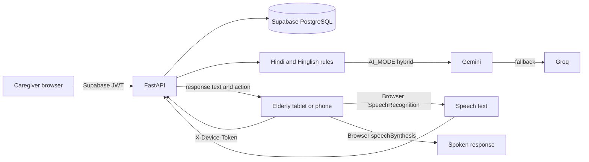

# SmritiVani architecture

## System overview

Caregiver and elderly devices use separate access mechanisms: JWT bearer auth for caregivers and an opaque, profile-bound device token for the elderly browser. Caregiver access is still enforced through Supabase RLS on the existing user-scoped REST API. The device-token middleware resolves a paired device through the proposed `paired_devices` table.

## Voice sequence

1. The browser recognizes Hindi, English, or the profile's configured speech language.
2. It sends recognized text and language to `/api/voice/text` with `X-Device-Token`.
3. The backend runs deterministic local intent, sentiment, and emergency rules.
4. For a non-emergency utterance, `AI_MODE=hybrid` tries Gemini then Groq. `mock` uses the local Hindi response generator.
5. The backend persists the interaction and any safety alert and returns a `VoiceResponse`.
6. The browser speaks the response and then applies the action (navigate, play, emergency, or remain in conversation).

## Database change boundary

`backend/schema/migrations/0004_device_pairing_voice.sql` is a proposed migration only. It adds pairing and voice data tables. No Supabase schema has been changed by this work. Do not deploy the new pairing or voice endpoints until this migration has been reviewed and applied.

